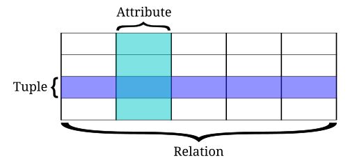

## Introduction

Tables are grouped into databases, and a collection of databases managed by a single PostgreSQL server instance constitutes a database cluster.

## Setting up 

*Database Cluster* - It is a Postgres Database Instance running in a server listening in particular PORT, it has a master storage folder where all the databases live
*Database* - isloated logical container inside cluster, meant for specific application or project 
*Schema* - a virtual folder or namespace inside a single database used to group related tables together , 

Minimal Postgres server setup 

1. Pull postgres:16 image
2. Create container
nerdctl run --name wa-postgres `
  -e POSTGRES_USER=postgres `
  -e POSTGRES_PASSWORD=postgres `
  -e POSTGRES_DB=postgres `
  -e TZ=Asia/Kolkata `
  -e PGTZ=Asia/Kolkata `
  -p 5435:5432 `
  -v "D:\docker-volumes:/var/lib/postgresql/data" `
  postgres:16

3. change ~/.psqlrc
4. change postgresql.conf file
5. \dt cd.* -> to list the schemas

## Relational Model

A relation consits of a heading and a body. heading consists of set of attributes called name and data type (domain), 

body is a set of tuples, and it has collection of n values , n is the relation's degree and each value in the tuple consists of unnique attribute , No of tuples in this set is the relation's *cardinality*

a Table or relation sometimes called as relvars (relation variables)

- Customer (Customer ID, Name)
- Order (Order ID, Customer ID, Invoice ID, Date)
- Invoice (Invoice ID, Customer ID, Order ID, Status)

*Attributes* are represented as *columns*
*tuples* as rows*
*Domain* is a set of valid values that a attribute can take
eg: if age is a attribute , then domain could be {0, 1, 2, 3, ..., 150} -- *DATA TYPE* in Postgres

### Sets and Relation

*Cartesian Product* is a set that has collections of all ordered pairs from the given sets (A, B) 
eg: A = {green, black, red}
B = {b,p}

resultant cartesian = (green, b), (green, p), (black, b), (black, p), (red, b), (red, p)

a *Relation* is a subset of Cartesian Product , which relates an element from one set ot another set 
`R= {(x,y):x ∈ A and y ∈ B}`

b is a image of a
*Domain* has the all the list of values available in the first set in a relation, it may or may not equal to set A,
*Range*, set which contains all the possible values in the second set in a relation 

### Keys

Keys are used to indentify rows and establish relationships between tables

Candidate Key is a minimal set of attributes that uniquely identify a row. 
1. Unique
2. Minimality 

Natural Key -> Keys that comes from the real world buisness data, like email, PAN number, ISBN, employee number
Surrogate Key -> generated with no buisness meaning, System generated id that has not context to the application data
Composite -> combination of columns that makes as a key 
eg : (Student_ID, Course_ID) in a Student Tutoring Table (Student_ID, Course_ID, Professor)

Here Student_ID and Course_ID are Prime Attributes , and other columns are called Non Prime Attributes

### Normalization
Database normalization is a database design process that organizes data into specific table structures. It helps to improve data integrity, prevent data anomalies, minimize data redundancy and bolster query performance. - ibm

#### 1NF
Every record should be unique

#### 2NF
having one primary key applied and all the non key attributes should be dependent on entire candidate key rather than any one part of the keys , this is called Partial dependency , 

| Student Id | Course Id | Course Name | Course Fee |
| --- | --- | --- | --- | 
| S101 | C01 | English | 1000 | 
| S102 | C02 | OS | 1500 | 
| S101 | C04 | DBMS | 1000 | 
| S103 | C01 | English | 1000 | 

Here Candidate key (Student Id, Course Id)
Course Name is dependent on Course Id and not on Student Id

STUDENT_ID	COURSE_ID
S101	C01
S102	C02
S101	C04
S104	C03
S104	C01
S102	C05

COURSE_ID	COURSE_NAME	COURSE_FEE
C01	DBMS	1000
C02	Operating Systems	1500
C03	Data Structures	1000
C04	Computer Networks	2000
C05	Java	2000

#### 3NF 

is a extension to 2NF , it solves transitive dependencies -> meaning non key attributes are dependent on another non key attribute like  , lets say the table is like this

| Student_ID | Student_Name | Dept_ID | Dept_Name        |
| ---------- | ------------ | ------- | ---------------- |
| S101       | Arun         | D01     | Computer Science |
| S102       | Ravi         | D01     | Computer Science |
| S103       | Kumar        | D02     | Electronics      |
| S104       | Priya        | D01     | Computer Science |

Here you can see the Dept Name is not depended on the Primary key but rather rely on a non key attribute called Dept_I, This is called Transitive dependency 
A -> B (Student_ID -> Dept_ID)
B -> C (Dept_ID -> Dept_Name)

A -> C ()
So if we have a Student_ID A , we can determine one dept_id
if we have Dept_ID , it point to exactly one Dept_name 
and if we have dept_id we can determine  

Splitting into seperate table solves the problem 
https://www.google.com/search?q=hOW+TO+CREATE+TABLES+IN+MARKDOWN&rlz=1C1GCEA_enIN1205IN1205&gs_lcrp=EgZjaHJvbWUyBggAEEUYOTIICAEQABgWGB4yCAgCEAAYFhgeMggIAxAAGBYYHjIICAQQABgWGB4yCAgFEAAYFhgeMggIBhAAGBYYHjIICAcQABgWGB4yCAgIEAAYFhgeMggICRAAGBYYHtIBCDQ0MzlqMGo3qAIAsAIA&sourceid=chrome&ie=UTF-8&fbs=ABfTbFVyMZGZf1hfvX9uKjN_-G8cqu7ocb7U6ah0xpkIrGMK4LpKPoHZrc4HVz9uOAATjT2whS8aQNdsb1nn47m_ZQdHB9gC5QFbkMU5k-hNOkzSdtH4CZUBbfeXR09jNyERwWUhT_5NH3huoI5pAHOXdwF_iOVUkFiI7uC5ZQAcY75JAGb_d8LQz1IOzeAWrXUQch5pGvTnF-hejMajxsknjtWRY5PQKA&aep=10&ntc=1&sxsrf=APpeQnvQimpgmvJWCh147FGKgzf7qo6dLw%3A1791206499587&mstk=AUtExfASYScgolkYAEomC4BjoKNzeJ3rrMXsGveJ-J7vCBONyBY0Xl_iGoiqTZ-czx_NdW27MVPCRuLXtLAGsuXcGMSDTxWzkdXUk9UCzUkPngk-hsuJH_D0SuYhxTD7suFiWsmq-VTcQMOFM0rPAJjb74k0JqMO7tkMgVEmQO3M6UGwtlFwd1cq4k8vTfpgG_6QE-vbZQixan8ZY9A4UtCOWWJMpKuGiHcUBMxM7ljUPFRPqd8MwchY8EdsEA&aioh=3&csuir=1&cs=1&udm=50

1. X is a super key (a unique identifier).
2. Y is a Prime Attribute (part of the primary key).

#### 3.5NF - Boyce-Codd Normal form --> BCNF
While 3NF fixed the problem of a non key column determining another non key column, BCNF 

In BCNF, the rule is absolute:
• For any dependency X → Y, X MUST be a super key. No exceptions.

So Lets take a Tutoring table Example Student Tutoring Table (Student_ID, Course, Professor) 
- Here Multiple student can choose same Course , and For a course multiple professors are there , and here the primary key is composite key of Student_ID, Course
Here Course_ID (a part of key attribute) can determined by Professor (a Non Key ), because prof teaches only one subject majorly. so a hidden dependency created
Professor -> Course, 

Here Non Key Professor determines key attribute Course , BCNF is violated 

Simply , *If a column determines another column, that starting column MUST be a candidate key (a unique identifier). No exceptions.*

Student_ID	Sport	Coach
S101	Cricket	Coach Dhoni
S102	Tennis	Coach Nadal
S101	Tennis	Coach Nadal
S103	Cricket	Coach Kohli

- You can see for row 2 and 3 , there are duplicate created 
- Insertion anamoly , if a student hires a Coach or Prof with no student enrolled , then the table will have no place for that new coach and Sport ( Course and Prof)
- Losing Data, if we delted the 

*Solution* - 

BCNF steps in and forces us to break the table so that Coach -> Sport gets its own home where Coach can finally be the boss (the Primary Key).

Table 1: Student & Coach Mapping
(Who trains with whom)
Student_ID	Coach
S101	Coach Dhoni
S102	Coach Nadal
S101	Coach Nadal
S103	Coach Kohli

Table 2: Coach & Sport Mapping
(Which coach teaches what sport. Here, Coach is the Primary Key!)
Coach (PK)	Sport
Coach Dhoni	Cricket
Coach Nadal	Tennis
Coach Kohli	Cricket