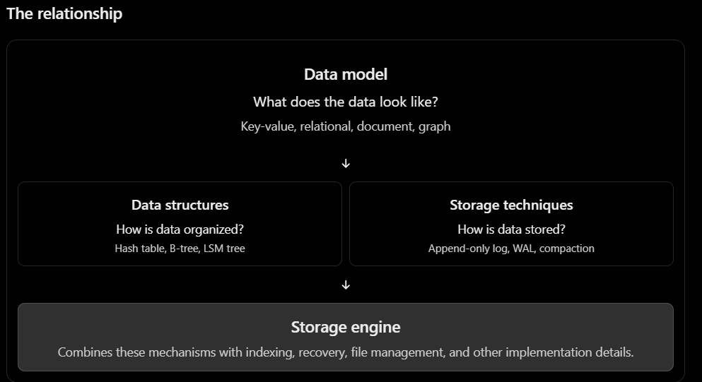
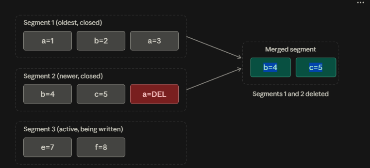

## Database and Storage system design - 11-database-framework

Database Storage system
         │             
         │             
         ▼             
   Storage Engine      
         │             
         │             
         ▼             
    Storage Technique  
         │             
         │             
         ▼             
    Physical Storage   

Data Model - How a data is logically represented and related (relational, key-value, document, graph, wide-column.)

Data Structure - How data is organized to retrieve it efficiently (hash table, B-tree, B+ tree, LSM tree, trie, skip list.) ordered/unordered flat files
hash tables
B+ trees
ISAM
heaps

Data Storage - Describe how data is written and maintained , Describes the strategy used to store and modify records. (append-only log, in-place updates, copy-on-write, write-ahead logging (WAL), immutable sorted files.)

Storage Engine - Combines data structures, storage techniques, indexing, recovery, and other mechanisms.

Examples: InnoDB (MySQL), WiredTiger (MongoDB), RocksDB.

Example: RocksDB uses an LSM-tree-based architecture with memtables, SSTables, and compaction.

## Log Append Storage

So as the name says, it for every write , data gets appended to a file,

### Hash map Indexing

Here for every byte offset of the keys are stored in a in memory hash map , so lets

say the values are stored in disk like this (byte, data)

0 ---- name=Ana (Older value)

9 ---- city=Pune

19 ---- age=40

26 ---- name=Ben

In RAM:
9  --> City
19 --> age
26 --> name

### Sorted String Tables
A log structured storage (key-value) pairs, with keys are sorted 

an sst file on disk will be like this 

Block 1 — offset 0

apple → red
banana → yellow
carrot → orange
cherry → red

Block 2 — offset 4096

grape → purple
kiwi → green
lemon → yellow
mango → orange

Block 3 — offset 8192

orange → orange
peach → pink
pear → green
plum → purple

Index key	Block offset
apple	0
grape	4096
orange	8192

The index entries are sorted too, so you can binary-search the index to find the appropriate block.

#### Filter Index
Min/Max Filter
Bloom filter - https://en.wikipedia.org/wiki/Bloom_filter

Here Merging is efficient because of mergeSort and produces a new merged sorted file which also has a sorted key 
if multiple segments has same keys , we can take the latest segment as the ultimate
also sparse indexing works like magic as each segments 

- Compaction and merging keep the number of segments small. Merging is cheap because the segments are sorted

### LSM - Log structure Merge
the principle of using SST and key-value pair based
In turn it has high write throughput

TODO : Lucene, elastic search, solr, cassandra,  ~~text~~,  DB, riak, AVL , Red Black Trees 

So In a LSM design,
The already sorted tables are immutable ones, that are intended only for reading

To make it sound hard, lets go to an example
- Imagine we are a maintaing a Dictionary of word and its meanings, So We Keep the words and its meaning in a Cabinet / Mini Dictionary (SSTables) These are arranged alphabetically 
- Along side we also have a Scratchpad (MemTable - an inmemory sorted data structure), this holds newly entered words eg.(delulu, rizz), this does not readily stored or placed with the Mini Dicts . Also before writing into a scratchpad , it is always written into a disk which is called as WAL, to protect memtable during powerfailure 

CASE 1 - Fresh Start 

 Incoming Data                    
      │                           
      │                           
      ▼                           
┌───────────────┐                 
│               │                 
│   Logbook     ├───Empty (disk)  
│    (WAL)      │                 
│               │                 
│   Scratchpad  ├───Empty (memory)
│  (MemTables)  │                 
│               │                 
│   Shelves     │                 
│   (SSTables)  │───Empty (disk)
│               │                 
│               │                 
└───────────────┘                 

CASE 2 - New words arrive 

        WAL                                                                 
┌────────────────────────────────────┐                                      
│     Record 1: Apple                │                                      
│                                    │                                      
│     Record 2: mango                │                                      
│                                    │                                      
│     Record 3: Zebra                │                                      
└────────────────────────────────────┘                                      
        Memtable                                                            
 ┌───────────────────────────────────┐                                      
 │     1. Apple                      │                                      
 │     2. Mango                      ┼──── Inserted and sorted immediately  
 │     3. Zebra                      │     because of the R&B Data structure
 │                                   │                                      
 │                                   │                                      
 └───────────────────────────────────┘                                      
                                                                            
      SST - Empty                                                           

CASE 3 - Memtable gets full

┌────────────────────────────────┐                             
│     Once the MemTable reached  │                             
│     its limit it tends to      │                             
│     frozen                     │                             
│                                │                             
└───────────────┬────────────────┘                             
                │                                              
                │                                              
                ▼                                              
 ┌──────────────────────────────┐                              
 │   A New SSTable gets created │        Generates bloom filter
 │   on disk , with sorted      │          and created sparse  
 │   words                      │           index into the RAM 
 │                              │                              
 └──────────────┬───────────────┘                              
                │                                              
                │                                              
 ┌──────────────▼────────────────┐                             
 │      Memtable is Cleared      │                             
 │      along side WAL           │                             
 │                               │                             
 └───────────────────────────────┘       

 CASE 4a - Fetching a record 

            QUERY : Apple                                                                   
                      │                                                                     
                      ▼                                                                     
                   MemTable                                                                 
              ┌─────────────────────────────┐           Apple Not                           
              │      Mango                  ├─────────   Present                            
              │      Zebra                  │              in                               
              │                             │           MemTable                            
              └────────┬────────────────────┘                                               
                       ▼                                                                    
                    The Shelf (SSTables)                                                    
┌──────────────────────────────────────────────────────────────────────┐                    
│       sst 1             sst 2               sst 3                    │                    
│     ┌───────────┐    ┌───────────┐       ┌───────────┐               │                    
│     │ apple v1  │    │  apple v2 │       │ zebra     │               │                    
│     │ (adam)    │    │   (newton)│       │  (newest) │               │                    
│     │           │    │           │       │           │               │                    
│     │           │    │           │       │           │               │                    
│     └───────────┘    └───────────┘       └───────────┘               │                    
│                                                                      │                    
└───────────────────┬──────────────────────────────────────────────────┘                    
                    │                                                                       
                    │                     Bloom filter tells that sst3 -> No                
                    └───────────────────             sst 2 -> Probably                      
                                             Using sparse tree , we can find the byte offset
                                              of apple location ,                           

 
CASE 4b - Merge thread 

                    The Shelf (SSTables)                                
┌──────────────────────────────────────────────────────────────────────┐
│       sst 1             sst 2               sst 3                    │
│     ┌───────────┐    ┌───────────┐       ┌───────────┐               │
│     │ apple v1  │    │  apple v2 │       │ zebra     │               │
│     │ (adam)    │    │   (newton)│       │  (newest) │               │
│     │           │    │           │       │           │               │
│     │           │    │           │       │           │               │
│     └───────────┘    └───────────┘       └───────────┘               │
│                                                                      │
└─────────────────────────────┬────────────────────────────────────────┘
                              │                                         
                      JANITOR │(Merge Thread)                           
                  ┌───────────▼───────────────────────────────┐         
                  │                                           │         
                  │  - Reads all 3 files sequentially         │         
                  │                                           │         
                  │  - Sees two records and throws apple v1   │         
                  │                                           │         
                  │  - Writes them into single file           │         
                  │                                           │         
                  │  - This is a background process, which runs         
                  │           occassionally                   │         
                  │                                           │         
                  │                                           │         
                  └──────────────┬────────────────────────────┘         
                                 │                                      
                              sst│1                                     
                           ┌─────▼─────┐                                
                           │  apple v2 │                                
                           │           │                                
                           │  zebra    │                                
                           │           │                                
                           └───────────┘                              

CASE 5 - Crash Recovery

Scratchpad (Running)       ----------> Log Book
|
|
Power Cut

After Power Restore

Scratchpad (Gets value from WAL) <------- Log Book
|
|
|_______________________________ > Deleted Logbook , system recovereed 

## How Data is read on a disk (HDD)

Plate - disk like structure as microscopic north and south poles
Spindle - a motor that rotates the disk with a constand speed
actuator Arm  - a mechanical arm with tiny magnetic head above spinning platter reads the magnetic fields 

Sector - a smallest part of a track 
Track - concentric cirles

### Read Process
1. Taking an offset the arm moves to the appropriate track , this is called seek time (milliseconds)
2. Spinning to take that specific sector 
3. and reading of that data of the sector 

"So Sequential is Good"